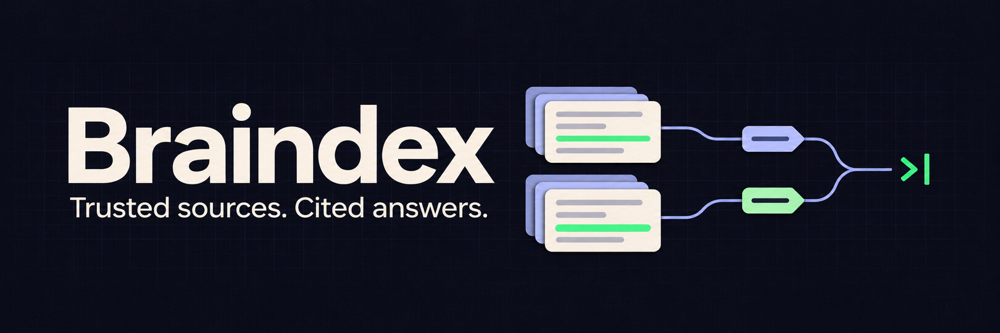

# 

Braindex is a local CLI that gives coding agents cited passages from the sources you trust. A brain can be one source or a collection. You decide which brains the agent consults for each topic.

## Build and try it

The core CLI is a single binary for macOS and Linux. Text import and keyword retrieval require no account, model, or background service. Ollama, Git, Tesseract, Heptabase, and provider credentials are used only by the features that need them.

From a source checkout with Go 1.26 or newer:

```sh
go build -o bin/braindex ./cmd/braindex
export PATH="$PWD/bin:$PATH"
export BRAINDEX_LIBRARY="$(mktemp -d)"
braindex init
braindex brain create founder-sales --name "Founder sales"
braindex source add examples/founder-led-sales/discovery.md --brain founder-sales
braindex rule set founder-led-sales --match "founder-led sales" --brain founder-sales
braindex index rebuild
braindex context "How should I run founder-led sales discovery?" --json
```

The result should show a matched `founder-led-sales` topic and `hits` from `founder-sales`. One cited passage is `discovery`, line 3, about choosing one workflow and one buyer decision.

This walkthrough uses a temporary library. Set `BRAINDEX_LIBRARY` to your preferred directory for ongoing use, or use `braindex --library PATH COMMAND` to select a library per command. Local Markdown, text, and text PDF imports produce line or page locators. `braindex source show ID REVISION` can display the text behind a citation. Rebuild the index after importing or installing sources. Rule changes take effect without a rebuild.

Connect your agent by adding a short instruction to your `AGENTS.md`. For automatic lookup on matching prompts, configure the optional Codex hook. Both call the same `braindex` binary. [Agent setup](docs/agent-integration.md) · [Synthetic walkthrough](examples/founder-led-sales/README.md) · [Brain packages](docs/brain-package.md)

## Install from a tagged release

With access to the private repository, [download the current prerelease](https://github.com/sam-bretz/braindex/releases/tag/v0.1.0-rc.1) or install it with:

```sh
GOPRIVATE=github.com/sam-bretz/braindex go install github.com/sam-bretz/braindex/cmd/braindex@v0.1.0-rc.1
```

The prerelease includes macOS and Linux archives for arm64 and amd64, plus SHA-256 checksums. See the [release guide](docs/releasing.md).

## Diagnose a library

Run `braindex status` to see each brain's searchable source count, keyword and embedding index freshness, and optional tools on your path. Use `--json` for scripts and `--check-runtime` to probe the configured embedding model over loopback. For a specific query, `context --json` distinguishes a rule that did not match, a selected brain without searchable text, access denial, and a search that found no relevant passages.

## Semantic search across brains

With a locally installed Ollama embedding model, build an optional embeddings index:

```sh
braindex index embed --model nomic-embed-text
braindex context "How can a startup tell if prospects will buy during a downturn?" \
  --brain sales --brain markets
```

Use your actual brain IDs. Repeat `--brain` to choose several sources of evidence, or use `--all-brains` to explicitly search the whole library subject to brain access rules. To make a combination the default for a topic, set the rule with multiple `--brain` flags. The agent tool and prompt hook use the same retrieval path.

Braindex ranks keyword and semantic matches separately for each selected brain and returns cited excerpts grouped by brain. Use `--mode keyword` to compare with keyword search, or `--mode semantic` to require an available embedding index. The optional similarity score describes the vector match, and the default cutoff can be changed at build time with `--min-similarity`.

The index is local and disposable. Run Ollama on loopback with its cloud features disabled. Braindex uses port 11434 by default, or the loopback port set by `BRAINDEX_OLLAMA_PORT`, and checks that the requested model is installed locally. It sends passage text when building and the question when searching. Re-run `index embed` after source changes or a model update. If the optional index is stale or Ollama is unavailable, the default mode falls back to keyword search and reports the embedding status. [Ollama embedding API](https://docs.ollama.com/api/embed) · [Ollama local-only settings](https://docs.ollama.com/faq#how-do-i-disable-ollamas-cloud-features)

## Capture material for later

```sh
braindex capture note "Ask prospects about the last time they evaluated this workflow."
braindex capture url https://example.org/article
braindex inbox list
braindex inbox review ITEM_ID
```

Use `braindex capture note -` to read a note from stdin. Ask an agent you trust to review selected items, then inspect its proposals. Approve the proposed placement with `braindex inbox approve ITEM_ID --use-proposal`, or choose a destination with `--brain ID` or `--new-brain ID`. Approval prompts in an interactive terminal. You can also defer or dismiss an item. Captures and proposals stay outside search and export until approved.

## Back up or share

Back up the library files and its `.braindex` metadata to storage you control. Keep the backup private when it includes subscriptions, inbox content, or other private files. Exclude `.braindex/index.sqlite*`, `.braindex/.index-build-*`, `.braindex/embeddings.sqlite*`, `.braindex/.embeddings-build-*`, `.braindex/library.lock`, and inbox `.lock` files. After restoring, run `braindex index rebuild` against the restored path. The saved source revisions hold searchable text and citations. Run `braindex backup status` to find external or missing originals. Keep external originals separately when you need the underlying files.

Use `braindex package export BRAIN_ID DIRECTORY --version 1.0.0` to create a separate package directory. Source links are the default. Include a specific source with `--include SOURCE_ID` only after marking it redistributable at import with `--redistribution allowed`. Inspect the package before sharing it. The recipient controls topic routing.

## Connectors

- Import a saved newsletter with `braindex source add issue.eml --brain yardeni`.
- Use `braindex discover web|rss|podcast URL --brain ID` to import a page or refresh a feed. Add `--create-brain` to bootstrap a destination. Repeat `--brain` to assign episodes to show and guest brains.
- Use `braindex discover youtube PLAYLIST --brain ID` with `BRAINDEX_YOUTUBE_API_KEY` for playlist metadata. Attach a local VTT or SRT file with `braindex source transcript SOURCE_ID TRANSCRIPT`. Episodes with missing transcripts show as unavailable.
- Import a local image with `braindex source add image.png --brain ID` after installing Tesseract. Citations include the recognized text region.

## Connect Gmail

In a Google Cloud project, enable the Gmail API, configure Google Auth Platform, and create an OAuth client of type **Desktop app**. If your app is in Testing, add your Gmail address as a test user. Download the Desktop client JSON to a private location outside the project. [Google Desktop OAuth setup](https://developers.google.com/identity/protocols/oauth2/native-app) · [Gmail scopes](https://developers.google.com/workspace/gmail/api/auth/scopes)

```sh
braindex gmail login --client-file "$HOME/path/to/client.json"
braindex gmail labels
braindex brain create yardeni
braindex sync gmail --label LABEL_ID --brain yardeni
```

Open the URL printed by `gmail login` while the command waits. Braindex requests read-only Gmail access, receives the callback on loopback, and saves the refresh token in a mode-0600 file under your OS user config directory. On macOS that is `~/Library/Application Support/braindex/gmail.json`. For sync, you can also supply `BRAINDEX_GMAIL_TOKEN`, or the `BRAINDEX_GMAIL_CLIENT_ID`, `BRAINDEX_GMAIL_REFRESH_TOKEN`, and optional `BRAINDEX_GMAIL_CLIENT_SECRET` variables. Schedule the one-shot sync with cron or launchd. Sync fetches messages from the selected label and rebuilds the index. The Google read-only permission itself applies to the account.

## Sync Heptabase into a brain

Install the official Heptabase CLI and enable it in Heptabase **Settings → AI Features**. Keep the desktop app running during sync. Find a whiteboard ID with `heptabase whiteboard list --name-filter NAME`, or a tag ID with `heptabase tag list --name-filter NAME`. [Heptabase CLI](https://support.heptabase.com/en/articles/14715462-heptabase-cli)

```sh
braindex brain create research
braindex sync heptabase --whiteboard WHITEBOARD_ID --brain research
# Or choose a tag:
braindex sync heptabase --tag TAG_ID --brain research
```

Sync reads the selected collection and rebuilds the index. Notes have card and block locators. Locally cached PDFs are extracted from a temporary copy and retain page locators. Other card types are recorded as unavailable for search. A PDF export failure is reported so it can be retried after opening the file in Heptabase. Repeated runs preserve source identities and pick up edits. This is an additive import. Cards removed from the Heptabase collection remain in Braindex. Use a private destination library for private notes.

## Install a shared brain

Use `braindex package install DIRECTORY` for a local export, or `braindex package install REPOSITORY --git --version 1.0.0` for a Git repository tagged `v1.0.0`. For a hosted catalog use `braindex catalog list URL` and `braindex catalog install URL PACKAGE_ID --version 1.0.0`. See the [static catalog pilot](docs/brain-package.md#static-catalog-pilot) to publish package files on an HTTPS host.

## Project information

[MIT license](LICENSE) · [Contributing](CONTRIBUTING.md) · [Security](SECURITY.md) · [Release checks](docs/releasing.md) · [Changelog](CHANGELOG.md) · [Retrieval benchmark](docs/retrieval-benchmark.md)

[Logo SVG](docs/assets/braindex-mark.svg) · [Logo PNG](docs/assets/braindex-mark.png) · [Social preview](docs/assets/braindex-social-preview.jpg)
