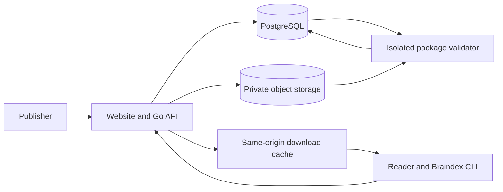

# Braindex Marketplace

**Status** Draft  
**Author** Sam Bretz  
**Related** [Braindex design](braindex-spec.md) · [Package format](../brain-package.md)

## Objective

Let curators publish a versioned brain that others can discover, inspect, and install into their own Braindex libraries.

Braindex already installs data packages from directories, tagged Git repositories, and static HTTPS catalogs. The marketplace adds a place to browse packages, authenticated publishing, and an operator workflow for handling reports and withdrawing releases. Braindex still searches the installed brain locally. The recipient decides which questions can consult it.

## Scope

Start with one public marketplace, free downloads, and invited publishers. Anyone can browse and download. Publishing requires a signed-in account and ownership of a publisher namespace. Each listing explains who curated the brain, what subjects it covers, what kinds of sources it includes, and how much becomes searchable immediately.

Payments, private listings, reviews, automatic updates, and independently verified publisher signatures are outside the first release. Marketplace users keep their private libraries, prompts, topic rules, connector credentials, and search history locally.

## How it works

1. **Publish.** A curator exports a brain, reviews the files and source permissions, signs in, and uploads a ZIP to their namespace. The publisher supplies a summary, tags, and redistribution information. The server validates the package and shows a preview with bundled and reference-only source counts. The first release from each publisher requires operator approval. Approved releases appear in search and can be installed by exact version.
2. **Install.** A reader finds a brain by topic or publisher, checks which sources are searchable, and copies an install command. Braindex downloads the selected version, verifies the digest and package, and adds the brain to the reader's local library. The reader rebuilds the index and chooses topic rules. A reference-only brain can be installed, but the reader still needs to obtain and import the source text.
3. **Release a new version.** The curator publishes a new version under the same listing. Existing installations stay pinned. During the pilot, readers can install the new version under a separate local brain ID. Updating in place is a later CLI change that must preserve local rules and access settings.
4. **Withdraw.** A publisher can yank a version to hide it from search and default recommendations. Its exact version remains available for reproducibility. An operator can block downloads when distribution must stop, including for a reported rights or security issue. This removes the release from install metadata and invalidates its cache entries. Copies already installed locally remain with recipients.

## Service and hosting

Deploy one Go service with a public website, authenticated publisher routes, and catalog endpoints. Use managed PostgreSQL for accounts, listings, releases, moderation, and the validation queue. Keep ZIP files in private object storage. Run archive validation in a separate process with bounded CPU, memory, disk, and runtime. The validator can read only its assigned staging object and has no general network access.

Put the site, catalog metadata, and public downloads on the same HTTPS origin. Route downloads through the service or a CDN on that origin. The CLI currently rejects cross-origin archive URLs and redirects. Public download routes must check release status. Raw storage URLs stay private. This allows the operator to stop serving a release.



Use one region for the pilot, with automated database backups and a restore drill. Keep storage location, hosting vendor, and CDN choices open until the team has a traffic estimate and a monthly budget. Measure validated upload size, queue time, download volume, and egress during the pilot.

## Identity and data model

| Record | Key fields and rules |
| --- | --- |
| Publisher | Immutable internal ID, unique public handle, provider account ID, display name, and moderation state. Account IDs are independent of display names. |
| Listing | Stable internal ID, publisher ID, unique slug within that publisher, expected v1 package ID, title, summary, tags, and visibility. Display metadata can change without changing a release. |
| Release | Listing ID, version, archive SHA-256, byte count, package schema version, bundle and reference counts, release notes, and state. Unique on listing and version. Published bytes and digest are immutable. |
| Submission | Owner, staging object, idempotency key, validation result, and expiry. Incomplete or failed submissions stay private. |
| Report and audit event | Reporter contact if supplied, release ID, reason, status, actor, and moderation decision. Access is limited to operators. |

Public identity is `publisher/slug`, for example `fieldnotes/early-sales`. The inner package keeps its existing v1 `package_id`, which is a flat identifier. The server binds it to the listing on first publication. Two publishers can therefore distribute packages with the same inner ID. Local installers can choose a distinct brain ID with `--brain`.

Use a stable identity from the login provider to establish control of a namespace. Treat the name in `brain.json` as package attribution. The website displays the marketplace account that actually uploaded the release separately. Account authentication establishes who published through this server. The archive checksum establishes which bytes the server listed.

## Public and publisher interfaces

| Proposed route | Behavior |
| --- | --- |
| `GET /brains?query=&tag=&cursor=` | Public, paginated search over listing titles, summaries, tags, and publisher handles. |
| `GET /p/{publisher}/{slug}` | Listing page with curator identity, source counts, release history, and an install command. |
| `GET /p/{publisher}/{slug}/catalog.json` | Existing v1 catalog shape scoped to one listing. Serve released versions by default. A version-scoped subroute exposes exact metadata for a yanked version that is still downloadable. Keep both within the current CLI's 1 MiB limit. |
| `GET /p/{publisher}/{slug}/releases/{version}/archive.zip` | Same-origin download for a specific version. Blocked releases return a structured error and no bytes. |
| `POST /publisher/listings/{slug}/submissions` | Authenticated upload and metadata submission with an idempotency key. Return a submission ID for polling. |
| `GET /publisher/submissions/{id}` | Owner-only validation status, preview, or rejection reason. |
| `POST /publisher/submissions/{id}/publish` | Publish a validated submission after any required approval. |
| `POST /reports` | Submit a report against a listing or release. Rate-limit and route to the operator queue. |

The listing page can generate a command the current installer understands:

```sh
braindex catalog install https://market.example/p/fieldnotes/early-sales/ early-sales --version 1.0.0 --brain fieldnotes-early-sales
braindex index rebuild
```

The v1 catalog entry must echo the archive manifest's package ID, version, and publisher string exactly. Rich discovery and account identity live in the marketplace routes. A future CLI can add `market search` and `market install publisher/slug@version` against a paginated API. It can reuse the archive validator.

## Publication and recovery

1. Accept authenticated uploads into private staging. Start with the current CLI limits of 64 MiB compressed, 129 MiB extracted, and 2,048 ZIP entries. Enforce the limits server-side before making anything public.
2. Validate paths, schema, asset hashes, and passage structure. Reject unexpected ZIP entries, executable content, links that escape the archive, and active configuration. Treat source URLs as inert metadata. Do not fetch them during validation. Calculate the archive digest on the server.
3. Store validated bytes at a digest-addressed key using a create-only write. A storage error leaves the submission unpublished. A retry can reuse bytes already present at that digest. [Example conditional object writes](https://docs.aws.amazon.com/AmazonS3/latest/userguide/conditional-writes.html)
4. In one database transaction, claim the unique listing and version, publish the release, and record the audit event. An identical retry returns the existing release. A retry with different bytes for the same version returns a conflict. Garbage-collect unreferenced staging and verified objects after the configured retention window.
5. Cache public metadata and downloads with a bounded lifetime. Blocking a release must invalidate both and prevent re-population at the origin. Measure worst-case block propagation in the pilot. Backup and restore must preserve blocked states and immutable version mappings.

## Security, privacy, and moderation

- Archive and passage text are untrusted data. Validate on both server and CLI. Render previews as escaped text. Packages cannot activate instructions or local rules. Curators can publish links without including the underlying material.
- Require a redistribution declaration for bundled material and expose a report flow for sensitive or unauthorized content. Capture operator actions in an audit log. Define who handles reports and what evidence is retained before opening publisher sign-ups.
- Rate-limit upload, search, download, and report endpoints independently. Keep staged and rejected material private and apply a retention limit. Do not log passage contents or secrets.
- Use HTTPS and pinned digests for the pilot. A digest served by the marketplace depends on trust in that marketplace. If independent verification or automatic updates becomes a requirement, design trust roots, key rotation, revocation, and rollback protection before shipping it. [The Update Framework specification](https://theupdateframework.github.io/specification/latest/)

## Alternatives considered

A curated static catalog is enough for an operator to host a small collection by hand. It is a useful first deployment check and the compatibility format for the CLI. Self-serve publishing and moderation need authenticated ownership and release state, which the service adds.

A Git repository per publisher can remain a distribution source. Marketplace listings still need one place to search, attribute uploads, and report a particular immutable release.

## Pilot acceptance and decisions

- Publish one bundled brain and one references-only brain. A clean install of each through the current CLI must behave as advertised and leave topic rules under recipient control.
- Try two publishers with the same inner package ID, a duplicate upload with different bytes, an interrupted upload, and an invalid archive. Each outcome must preserve namespace ownership and existing releases.
- Yank one release and verify exact-version install still works. Block another and verify search, catalog responses, and cached downloads stop serving it. Restore the database and confirm both states persist.
- Before rollout, choose the hosting budget, the operator who will review submissions and reports, and the retention window for staged or blocked packages. Set availability and block-propagation targets after measuring the pilot.
- Decide whether open publisher registration, publisher signing, or private and paid brains belong in a later phase. Each changes the account, trust, or download model.
