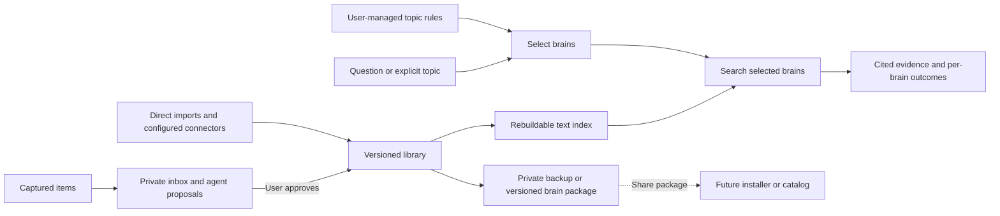

# Braindex

**Author** Sam Bretz  
**Status** Approved for issue planning  
**Date** 2026-11-07  
**Predecessor** [Braindex design notes](braindex.md)

## Overview

Braindex helps an agent answer with evidence from sources you trust. A brain is any source or collection you find useful for a topic. It can be a single document, a dataset, a newsletter archive, a person’s work, or a collection assembled around a subject. Supported import formats determine what can be searched in each release.

You decide which brains to consult for each kind of question. Braindex uses those choices to narrow the evidence an agent sees and returns excerpts with a page, chapter, issue, or timestamp so you can verify what the agent quotes.

The first milestone covers the shortest complete workflow. Add a local copy of *Founding Sales* to a Pete Kazanjy brain, set a founder-led sales rule, and ask an agent a matching question. Later milestones cover a capture inbox with agent-assisted review, scheduled newsletter sync, web and media sources, and richer agent integrations.

## The Problem

The user already collects material in a `Brains` folder, but an agent has no dependable way to tell when that material is relevant, where to look, or where a quoted passage came from. Each new source format also creates a separate manual collection workflow. A personal library may contain paid newsletters and books alongside material the user wants to share, so restoring the whole library and sharing one brain serve different purposes.

## Goals

1. **Let the user decide what evidence to consult.** The user can define or edit which brains a topic selects. In a repeatable agent walkthrough, a founder-led sales question triggers a search of the required brain. The output identifies each required brain searched, distinguishes a hit from a search with no relevant passage, and gives a locator for any excerpt used.
2. **Bring existing sources into the library.** The first release imports local Markdown, plain text, and text PDFs. Adding the same source twice avoids duplicate results. A source can appear in several brains while retaining its identity and attribution.
3. **Restore the library and share selectively.** A fresh checkout of a private backup can rebuild the search index offline and reproduce fixture results. A share export includes source links by default and admits explicitly selected redistributable material. A fixture verifies that private content, credentials, and derived index files are excluded.
4. **Make brains installable in the future.** Export a versioned package that a later CLI installer can accept from a local directory, Git, or a hosted catalog. A recipient controls which questions use an installed brain.
5. **Capture first and curate later.** A user can stage material, review an agent’s proposed use, and decide what belongs in an existing or new brain.
6. **Extend ingestion after the first release.** Start with saved newsletter messages, then verify scheduled sync against a dedicated mailbox label or folder. Add web pages and feeds, video and podcast discovery, transcript import, and image OCR in stages. A discovered item with unavailable text remains visible with its coverage status.
7. **Make the CLI usable as an open-source project.** The public repository includes setup instructions and a synthetic library that exercises the end-to-end workflow.

## Non-Goals

- A hosted catalog, remote installation, or shared editing in the first release.
- Automatic imitation of an author's voice or persona.
- Cloud model calls during local import or retrieval. A later inbox review can use an agent the user explicitly invokes.
- Agent-assisted inbox review, scheduled mailbox sync, automatic media transcription, image OCR, MCP, or prompt hooks in the first milestone.
- An implementation or public release as part of this specification and issue-writing pass.

## Technical Plan (Architecture)

### Library and source records

Keep the existing `Brains` folder as the library root and write Braindex metadata beside existing files. A brain has a stable ID, a display name, and source memberships. It can contain one source or many. Any label describing what the brain represents is optional metadata and has no effect on which queries select it. A source has a stable ID and can belong to multiple brains. Each imported revision stores normalized text, the source title and attribution when known, and locators for its passages. An item with unavailable or unextractable text stays visible with a status.

Use versioned text manifests and normalized passage files as the durable library. Keep a local SQLite full-text index that can be rebuilt from those files offline. Reimporting unchanged content preserves the source identity and revision. An updated source gets a new revision so that an earlier citation can still identify the text it quoted. Use file fingerprints for deduplication and provider identifiers when connectors supply them. [SQLite FTS5](https://www.sqlite.org/fts5.html)

### User-controlled routing

A rule is a user-maintained mapping from a topic ID to one or more brain IDs. The user can change that mapping without reimporting sources or rebuilding the text index. The first release resolves a topic from an explicit topic ID or configured phrases in the question. The agent can suggest a topic ID, but the user's mapping determines which brains that topic selects. If multiple phrase rules match, search the union of their brains. If no rule matches and the user did not explicitly choose a brain, return that outcome so the agent can continue without Braindex evidence.

Search each selected brain independently. Apply the configured agent access policy before returning excerpts, and report outcomes per brain, including no relevant passages, unavailable content, or exclusion by policy. Rank passages within the selected brains. The proposed default is to keep automatic retrieval scoped to those brains even when results are empty. Users can explicitly search another brain when they want a wider view. This keeps retrieval ranking from substituting a different source for one the user chose.

### CLI and agent boundary

Provide CLI operations to initialize the library, manage brains and their sources, manage topic rules, retrieve context, rebuild the index, and export a brain. The first agent integration calls the CLI using an explicit instruction. For a matched request, return structured data with the selected topic, each brain's outcome, and bounded excerpts with source identity, revision, locator, and attribution. A source excerpt is untrusted text. The integration tells the agent to treat it as evidence, quote it accurately, and identify any synthesis as its own. Agent invocation and topic matching are separate checks in the first walkthrough. MCP and agent-specific hooks can reuse this retrieval interface later.

### Capture inbox and agent review

Capture a note, file, or URL into a private inbox without choosing a brain. Store the original input and its provenance under an inbox item ID. A captured URL may remain a reference until the user chooses to fetch it. Inbox items and agent proposals stay outside brain membership, retrieval, and share exports until the user approves an addition.

The user can ask an agent they already use to review selected items through the CLI. The agent can compare an item with authorized brain descriptions or evidence, then save a structured proposal with a short digest, why it might be useful, and one or more suggested destinations. A proposal can recommend an existing brain, suggest a new one, or recommend leaving the item out. Keep proposals separate from the original source, identify them as agent-generated, and record which item revision they reviewed. A failed or interrupted review leaves the captured item available for retry or manual review. Sending captured content to an agent is a separate, user-initiated action that uses the agent's configured provider.

The review queue shows pending items and completed proposals. From one view the user can inspect the original and digest, accept or edit a destination, add to multiple brains, create a brain, defer, or dismiss. The agent review interface can save proposals. Only a separate user confirmation promotes an item. Promotion reuses the ordinary import path, records the approved destinations, and can retry without duplicating a source or membership. The user can also place an item manually without waiting for an agent review.

### Backup and sharing

Private backup includes the files necessary for offline restore and reports any references to external files that the backup cannot restore. A share export writes into a fresh directory with an allowlist for source links and explicitly selected redistributable material. Keep credentials, private mailbox metadata, and the derived search index out of share exports. The public CLI example uses synthetic source files.

### Installable brain packages

A brain can travel independently of its author's library. The export is a versioned data package with a manifest, a package identity, publisher attribution when supplied, and a list of included sources. The package preserves provenance, redistribution information, and passage locators for any included text. Source links and bundled material are distinct entries, so installing a references-only brain would show which sources still need to be obtained before they can be searched.

The first milestone writes and validates the package format locally. A later release can install the same format from a local folder or Git. A hosted Braindex catalog can eventually index published packages, expose their versions, and let the CLI download a selected version for local validation and installation. The catalog distributes packages. Topic rules and retrieval stay in the user's library.

Installation adds a brain as an available source of evidence. The recipient decides whether and where to use it. Packages contain data only, carry no active rules or agent instructions, and run no code on installation. A later installer should pin the installed package version and record its origin so users can review updates before applying them.

### Later connectors

Future connectors share the local import contract. They can discover source records, attach extractable text, and update each revision independently. This keeps playlist or feed discovery separate from transcript availability and lets scheduled sync retry failed items.

## Alternatives Considered

### Store the entire library in a database

A database could commit source and index updates together and make single-file backup convenient. It would make Git diffs and selective sharing harder to inspect. The plan keeps the durable library in files that can be reviewed or restored independently and uses SQLite for search. This adds a rebuild step and requires the implementation to keep the index consistent with published revisions.

### Let retrieval choose brains from the entire library

Ranking passages across all brains could help with questions the user has yet to classify and surface unexpected connections. It could also omit a brain the user deliberately chose for the topic or introduce a source the user did not intend to consult. The plan makes the user's rules authoritative for automatic retrieval and leaves broader searches available as an explicit choice.

### Send whole sources or brains to the agent

Whole sources give the agent more surrounding context and may preserve an argument that spans several sections. They also increase how much private material enters the agent context and make it harder to trace an answer to a specific passage. The plan returns bounded excerpts with locators. The user can open the source for more context.

### Require a dedicated agent hook for the first release

A hook could invoke retrieval on every prompt and reduce reliance on the agent following an instruction. It would tie the first release to one host's setup and could run on unrelated prompts. The first milestone verifies an explicit CLI call and its response. A later opt-in hook can use the same interface, with its own invocation and access checks.

## Detailed Implementation Plan

### First release

1. **Initialize and manage a library.** Add CLI operations for selecting an existing library root, initializing Braindex metadata, and creating and listing brains. Validate stable IDs and store source memberships independently of brain labels. Exercise initialization against an existing folder with unrelated files.
2. **Import and revise sources.** Read Markdown, plain text, and text PDFs. Normalize passages with stable locators and persist content and provenance in a revision. Publish a revision only after its files are complete. Reimport an unchanged source without duplicating it, and support linking the same source to a second brain.
3. **Build and query the index.** Build a local full-text index from committed revisions. Support explicit offline rebuild. Check that the index covers the current library before answering and report when a rebuild is required. Rebuild a clean checkout and compare deterministic fixture results.
4. **Manage rules and return cited context.** Add CLI operations to add, update, and list topic rules. Resolve explicit topic IDs and configured phrases, then apply the user's selected brains and access policy before searching. Return structured per-brain outcomes and source citations. Test explicit topic selection, overlapping rules, no match, no relevant passages, and a denied brain.
5. **Export and validate a brain package.** Define the manifest schema and write a fresh export directory from an allowlist. Include a schema version, package ID and version, title, optional publisher attribution, and source entries identifying references or bundled data. Validate manifest shape and ensure each bundled path stays inside the package. Check that the export excludes private text and metadata, credentials, rules, and generated indexes. Test a references-only package and a synthetic package with included excerpts and locators.
6. **Verify the agent workflow and document it.** Provide a synthetic library and a sample agent instruction. Run a matching and unrelated prompt and verify the actual tool invocation and citations. Document the local backup, export, and restore workflows and the distinction between exported references and searchable bundled text.

### Documentation, schema, and examples

| File | Purpose |
| --- | --- |
| `README.md` | Install the CLI, build a brain, set a topic rule, retrieve a citation, and back up or export. |
| `docs/agent-integration.md` | Explain setup, expected invocation, citation behavior, and the agent access boundary. |
| `docs/brain-package.md` | Specify the versioned manifest and the future install contract. |
| `schemas/brain-package.v1.schema.json` | Define the manifest that the exporter and a future installer can validate. |
| `examples/founder-led-sales/README.md` | Walk through the synthetic source and rule with expected outcomes. |
| `examples/founder-led-sales/discovery.md` | Provide synthetic text that can be distributed in the public repository. |

### Go packages and files

The CLI is a Go executable. Use the Go 1.25 toolchain available in the workspace for the initial build and verify the supported Go baseline when pinning dependencies. Keep the executable free of cgo and target macOS arm64 for the first runnable artifact. Cross-build Linux amd64 as a portability check.

| File | Purpose |
| --- | --- |
| `go.mod`, `go.sum` | Declare the Go module and pin dependency versions and checksums. |
| `.gitignore` | Exclude local builds and derived example indexes. |
| `cmd/braindex/main.go` | Wire arguments, input and output streams, and process exit status to the CLI runner. |
| `internal/cli/run.go`, `internal/cli/run_test.go` | Dispatch library, brain, source, rule, context, rebuild, and export commands. Verify workflows through their normal CLI entry points. |
| `internal/library/store.go`, `internal/library/store_test.go` | Define the persisted records and library operations, validate IDs, and publish revisions and memberships safely. Test existing folders, duplicate imports, and retry behavior. |
| `internal/ingest/extract.go`, `internal/ingest/extract_test.go` | Extract Markdown and plain-text passages with line ranges and PDF passages with page numbers. Test inaccessible files, empty extraction, and page attribution. |
| `internal/ingest/testdata/two-pages.pdf` | Supply a redistributable synthetic PDF whose pages contain different known passages. |
| `internal/index/index.go`, `internal/index/index_test.go` | Build and query the disposable FTS5 index. Verify FTS5 on the pinned driver and test rebuild and deterministic ordering. |
| `internal/retrieval/context.go`, `internal/retrieval/context_test.go` | Resolve topic rules, apply access policy, search selected brains, and assemble cited JSON. Test the routing outcomes and excerpt boundaries. |
| `internal/brainpackage/export.go`, `internal/brainpackage/export_test.go` | Export and validate allowlisted brain data. Exercise references-only and bundled packages and reject unsafe paths. |

Evaluate `modernc.org/sqlite` for FTS5 and a Go PDF text library for page-aware extraction. Pin versions only after the module builds with cgo disabled and both fixtures pass. If a PDF library cannot extract the fixture with reliable page locators, bring the trade-off between a local extractor dependency and embedded PDF support back for review before changing the installation contract. [SQLite driver documentation](https://pkg.go.dev/modernc.org/sqlite)

### Verification plan

- Run `go test ./...`, `go vet ./...`, and `CGO_ENABLED=0 go build -o bin/braindex ./cmd/braindex`.
- Cross-build with `GOOS=linux GOARCH=amd64 CGO_ENABLED=0 go build -o bin/braindex-linux-amd64 ./cmd/braindex`. Record build and native runtime verification separately.
- Run the CLI fixture against a temporary library. Verify two imports of the same source, membership in two brains, a rule change without reindexing, citation against the original revision, and an offline rebuild in a fresh checkout.
- Verify a synthetic export from a library containing private files, rules, and credentials. Confirm that only allowlisted package files appear.
- Run the agent walkthrough on synthetic content and record whether the agent invoked the CLI, selected the expected brains, and cited the source accurately. Verify that an unrelated question and an empty result yield distinct outcomes.

### Follow-up milestones

- Add inbox capture, proposal review, and explicit promotion. Verify with a fixture that a captured item and its proposal cannot appear in retrieval or export, a failed review remains retryable, and repeated approval cannot create duplicate memberships.
- Import local email files and pilot a scheduled mailbox connector. Keep messages in the recipient's private library by default.
- Add web and RSS ingestion, media discovery and transcript import, and image OCR as separate increments.
- Install packages from a local directory or Git. Validate the package before import, preserve its provenance, and leave topic rules under recipient control. Prove export-to-install with a synthetic brain in a second library.
- Add a hosted catalog and CLI discovery and download. Reuse the local installer for the downloaded version. Track publisher identity, integrity verification, and catalog policies as future design work.
- Add MCP or an opt-in agent hook when the CLI contract and invocation walkthrough are stable.

*Drafted with EGM*
