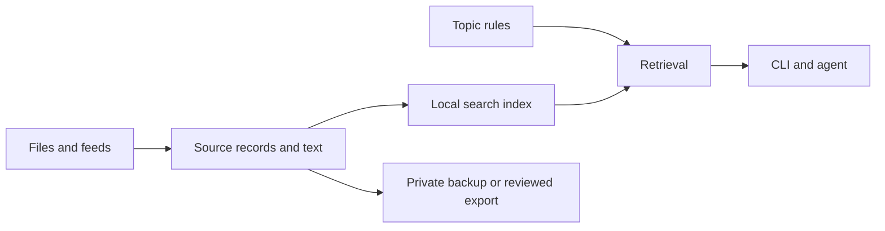

# Braindex

**Draft · Sam Bretz · 2026-11-07**

Braindex gives an agent source-backed answers from a collection you curate and keeps that collection usable outside any one agent.

## The workflow

- Add an accessible local copy of *Founding Sales* to a Pete Kazanjy brain. Create a rule for founder-led sales, first sales hires, and early customer discovery. When you ask an agent how to run your first discovery calls, it checks that brain and returns relevant passages with chapter or page references. [Founding Sales](https://www.foundingsales.com/)
- Create an Ed Yardeni brain. Start with saved newsletter messages, then connect a dedicated mailbox label or folder for scheduled sync. Search results retain the issue date and subject so you can distinguish what Yardeni wrote at different points in time.
- Bootstrap a brain from a YouTube playlist or podcast feed. Show discovered episodes and which have searchable text. Add an episode to both the show brain and a guest brain using one source record. If the transcript has reliable speaker labels, cite the relevant speaker and timestamp. Otherwise attribute the passage to the episode.
- Back up the library to a Git repo with access you control. Share a single brain through a separate export containing source links and explicitly selected material you can redistribute. The public CLI repo ships with a synthetic example brain.

## Files and index

Keep the user's existing `Brains` folder as the library root. Initialization adds Braindex metadata beside existing material. Importing registers files in place when possible. External files are copied into the library or explicitly referenced as external dependencies, which the backup manifest flags.

A **brain** is a named collection. A **source** is a book, issue, article, image, or episode. A source can belong to several brains. A **feed** discovers or refreshes sources. A **rule** maps a topic and examples to required brain IDs.

Store brain manifests, rules, and source records in versioned text files. Preserve original files or stable references and keep normalized text with source locators. Use canonical provider IDs when available and content fingerprints for local deduplication. Preserve a revision identifier in each passage citation so an updated document cannot silently change what a prior citation referred to. Make SQLite FTS5 a disposable search index. Rebuild it from the library without a network connection. Start with keyword ranking and measure misses on paraphrased questions before choosing a semantic retrieval layer. [SQLite FTS5](https://www.sqlite.org/fts5.html)



## Agent integration

The first integration is an explicit agent instruction to run `braindex context "<question>" --json` for knowledge questions. The agent may supply a topic ID when it recognizes the rule. The CLI also matches configured phrases and accepts an explicit topic override. Each matching rule contributes required brains. Retrieve separately from each required brain so general results cannot crowd them out, and report each brain's status as hits, no relevant passages, unavailable, or excluded by access policy. Return bounded excerpts with title, author or speaker when known, date, locator, and source revision. The agent cites those excerpts and distinguishes source statements from its own synthesis.

Add a read-only MCP adapter once the CLI response contract works. An optional agent-specific prompt hook can call the same retrieval path for more consistent invocation. Keep the hook opt-in and pass prompt text through structured input. Rule matching can guarantee which brains Braindex searches after invocation. Each agent integration needs its own invocation test.

## Ingestion and sharing

Use the same import contract for local files and future connectors. An import yields metadata, normalized text with locators when available, and a status. Preserve metadata for a source that lacks extractable text, and show the gap in status and search diagnostics. Refreshes use stable source IDs, commit each completed revision atomically, and can retry without duplicating sources or skipping failed items.

Start with local Markdown, plain text, and text PDFs. Add local email files and one scheduled mailbox adapter for the newsletter workflow. Follow with web pages and RSS, then YouTube and podcast discovery with supplied or accessible transcripts. YouTube documents playlist listing and requires video edit permission for its caption download API. Keep playlist discovery and transcript import separate so unavailable captions surface as a real coverage gap. Add image attachments with local OCR as a separate capability. Cite OCR by image and region where available, and use it for visible text. [YouTube playlist listing](https://developers.google.com/youtube/data/reference/rest/v3/playlistItems/list) · [YouTube caption download](https://developers.google.com/youtube/data/reference/rest/v3/captions/download)

Keep credentials and the search index outside Git. Keep mailbox selectors and other private metadata out of share exports. Use an allowlist for exported files and generate a fresh directory for review, separate from private Git history. Treat source text as untrusted evidence, including any instructions embedded in it. Offer an agent-facing allowlist because an agent can forward retrieved excerpts to its configured model provider. Local CLI search and indexing require no model account.

## First milestone

Proposed interface, using an example library path:

```sh
braindex init ~/Brains
braindex brain create pete-kazanjy --kind person
braindex source add ./founding-sales.pdf --brain pete-kazanjy
braindex rule add founder-led-sales --brain pete-kazanjy --match "founder-led sales"
braindex context "How should I run founder-led sales discovery?" --json
```

The milestone is complete when a fixture proves that an agent consults the required brain on a matching prompt, returns a passage with a verifiable locator, and reports the outcome for an unrelated or unanswered question. Reimporting the same source must preserve its identity and avoid duplicate results. Restoring the library into a fresh checkout must produce equivalent results after rebuilding the index offline. An export fixture must exclude private source text, private metadata, and derived files.

Use a private pilot with one book and a handful of saved newsletter issues to measure retrieval on the user's actual questions. Hosted services, autonomous persona simulation, and model-generated summaries are outside this milestone.

## Alternatives and open decisions

- A database-only library would simplify some writes. Text manifests and a rebuildable index make Git diffs and restores easier to inspect.
- Full-library prompt injection would give the agent broad context. Bounded excerpts make attribution, privacy controls, and prompt size easier to manage.
- The existing folder structure and accessible book format determine the first import path. Confirm them before implementation.
- The first mailbox adapter depends on which mail provider and newsletter label the user wants to use. Establish that during the newsletter pilot.
- Test rule recall with questions that avoid the configured keywords. Use the results to decide whether agent-supplied topic IDs are sufficient or semantic routing belongs in the next release.
